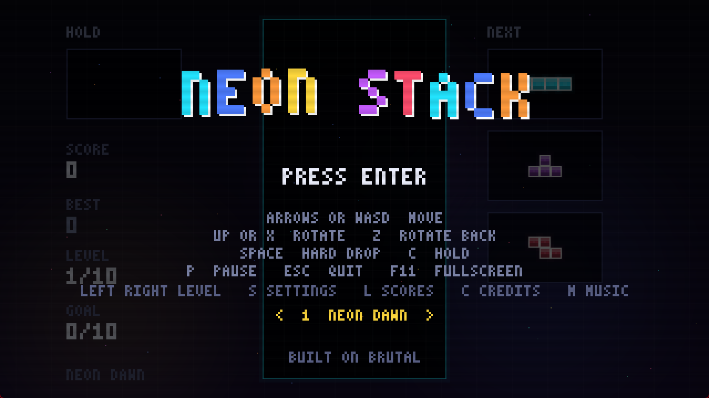
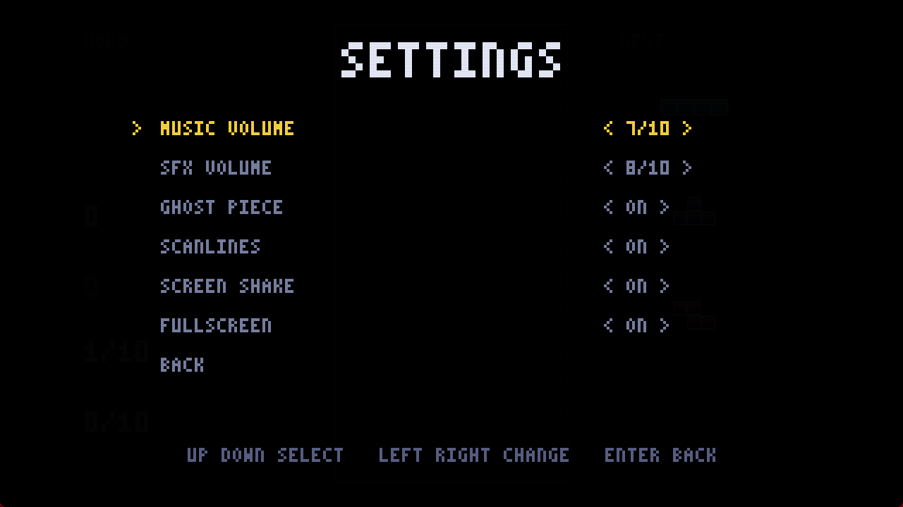
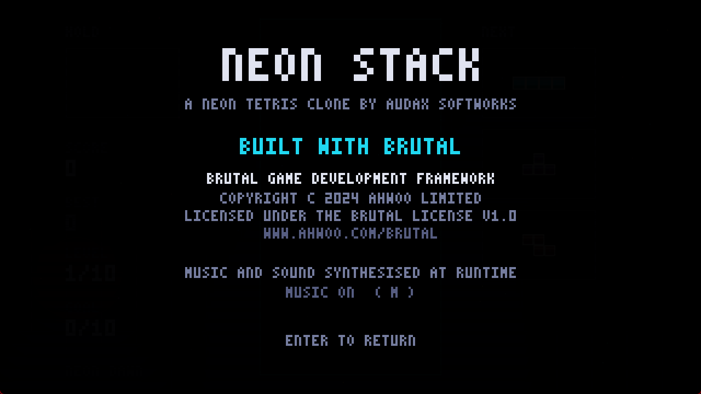

<div align="center">

# 🕹️ NEON STACK

### *Neon, CRT-scanlined Tetris on the BRUTAL framework*

**SRS + Kicks &bull; Ten Levels &bull; Chiptune + SFX &bull; Local Leaderboard**

<br />

<!-- Tier 1: project metadata -->
<p align="center">
  <a href="https://github.com/LeTrollologist/Neonstack/releases/latest">
    
  </a>
  <a href="https://www.ahwoo.com/brutal">
    
  </a>
  <a href="#resolution-and-scaling">
    
  </a>
  <a href="#campaign">
    
  </a>
  <a href="#sound">
    
  </a>
  <a href="LICENSE">
    
  </a>
</p>

<!-- Tier 2: platforms and stack -->
<p align="center">
  
  &nbsp;
  
  &nbsp;
  
  &nbsp;
  
</p>

<!-- Tier 3: quick navigation -->
<p align="center">
  <a href="#download">
    
  </a>
  &nbsp;
  <a href="#controls">
    
  </a>
  &nbsp;
  <a href="#campaign">
    
  </a>
  &nbsp;
  <a href="#leaderboard">
    
  </a>
</p>

<br />



</div>

---

## The Game

NEON STACK is a neon, CRT-scanlined take on Tetris, written in C# directly on the **BRUTAL**
framework. It ships as a self-contained game for Windows and Linux, with a ten-level campaign, a
guideline-style rule set, synthesised music and a local high-score table.

- **SRS rotation + kicks**, 7-bag randomiser, hold, ghost piece, lock delay, DAS/ARR.
- **Ten-level campaign** with line goals, unlocks, level-clear and victory screens.
- **640×360 pixel art** rendered at an integer multiple of the window (1×–6×) and blitted 1:1.
- **Fullscreen by default**, F11 to toggle, resizable window at any size.
- **Procedural audio**: a 15-second chiptune loop and fifteen sound effects, mixed live.
- **Settings and a local top-10 leaderboard**, both persisted per user.
- **BRUTAL licence compliant**: official logo before gameplay, credits screen, `NOTICE.txt` shipped.

## Download

Grab the latest build from the [Releases](https://github.com/LeTrollologist/Neonstack/releases/latest) page:

| Build | Asset | Requirements |
| --- | --- | --- |
| Windows x64 | `NeonStack-v1.0.0-win-x64.zip` | Windows 10/11, an OpenGL driver |
| Linux x64 | `NeonStack-v1.0.0-linux-x64.zip` | glibc-based distro, an OpenGL driver |

Both packages are **self-contained**: unzip, then run `NeonStack.exe` (Windows) or `./NeonStack`
(Linux). No .NET install is required. Save data goes to the per-user folder, not the game folder.

## Run From Source

```
dotnet restore
dotnet run -c Release
```

Needs the **.NET 10 SDK** and a desktop OpenGL driver. The project has no third-party runtime
dependencies beyond the BRUTAL packages (pinned in `NeonStack.csproj`).

| Flag | Effect |
| --- | --- |
| `--fullscreen` | Force fullscreen on launch (also the default) |
| `--windowed` | Start in a window for this session |
| `--scale=N` | Force the window to N × 640×360 (1..6) |
| `--dump-music=FILE` | Write the generated soundtrack to a WAV and exit |

The initial window mode can also be changed in Settings, which is persisted.

---

## Controls

| Action | Keys |
| --- | --- |
| Move | Arrows / WASD |
| Rotate CW / CCW | Up or X / Z |
| Hard drop | Space |
| Hold | C |
| Pause | P or Esc |
| Fullscreen | F11 |
| Music on/off | M |
| Start / confirm | Enter or Space |
| Quit | Esc on the title screen |

**Title screen:** Left / Right choose an unlocked level, **S** settings, **L** leaderboard,
**C** credits.  
**Settings:** Up / Down select, Left / Right change, Enter / Esc back.  
**Name entry:** Up / Down pick a letter, Left / Right pick a slot, Enter confirms.

## Campaign

Ten levels, each with a line goal and a fixed drop interval. Clearing the goal shows a Level Clear
screen, unlocks the next level and carries the score forward; clearing the last level shows the
campaign victory screen. Progress is remembered, and the title screen can start any unlocked level.

| # | Level | Goal | Drop interval |
| --- | --- | --- | --- |
| 1 | NEON DAWN | 10 | 0.85 s |
| 2 | STATIC BLOOM | 12 | 0.72 s |
| 3 | CIRCUIT RAIN | 14 | 0.62 s |
| 4 | VOLT RUSH | 16 | 0.53 s |
| 5 | GRIDLOCK | 18 | 0.45 s |
| 6 | CHROME FALL | 20 | 0.38 s |
| 7 | AFTERGLOW | 22 | 0.32 s |
| 8 | OVERCLOCK | 24 | 0.27 s |
| 9 | BLACKOUT | 26 | 0.22 s |
| 10 | FINAL STACK | 30 | 0.17 s |

## Resolution and Scaling

The game is authored in a fixed 640×360 logical space. The framebuffer is rendered at the largest
**integer** multiple of that space the window can hold (1×–6×) and blitted 1:1, centred with black
letterboxing. That keeps pixels square and hairlines crisp at any window size, Windows display
scaling / HiDPI, and fullscreen, instead of stretching a 640×360 image with a fractional GL pixel
zoom. The window opens at the largest whole multiple that fits the monitor work area; the game
starts fullscreen at the native mode (3× at 1080p). Scanlines are generated in physical pixels, so
their density does not change with the window size.

## Sound

A 15-second chiptune loop (128 BPM, Am–F–C–G) and fifteen sound effects are synthesised at startup,
so there are no audio files and no audio library dependency. A small software mixer plays music and
effects together through winmm `waveOut` on Windows, or a raw PCM pipe (`pw-cat`, `paplay` or
`aplay`) on Linux. If no output is available the game runs silently.

The loop is DC-blocked, low-end controlled and faded in over the first 0.8 seconds; the mixer streams
through eight 512-sample buffers (~93 ms of cushion) from an above-normal-priority thread. M toggles
music; both volumes live in Settings. `--dump-music=track.wav` writes the generated loop.

Effects include move/rotate blips, lock and hard-drop impacts, escalating line-clear arpeggios, a
level-up fanfare, game-over/win stingers and menu feedback, plus visual line-clear flash, floating
combo/clear text, screen shake and a hard-drop dust burst.

## Settings

Press **S** on the title screen. Options are saved to `settings.txt` and applied live:

- music volume and SFX volume (0–10)
- ghost piece, scanlines, screen shake
- fullscreen on launch (toggles the window immediately)

## Leaderboard

A local top-10 table with three-letter initials, score, level reached and lines cleared, stored in
`scores.txt`. A qualifying run prompts for initials after the game over; the table is reachable from
the title screen with **L**, and the new entry is highlighted.

## Startup Sequence

`Audax Softworks` ident → official `BRUTAL` logo → title screen. Enter / Space advances, Esc skips.
The BRUTAL logo is the official asset, shown unaltered apart from uniform scaling, before gameplay
(licence section 2.2).

## Save Data

Settings, scores, best score and campaign progress are written to a per-user folder:

- **Windows:** `%LOCALAPPDATA%\NeonStack`
- **Linux:** `$XDG_DATA_HOME/NeonStack` (usually `~/.local/share/NeonStack`)

Files: `settings.txt`, `scores.txt`, `best.txt`, `progress.txt`. If the folder cannot be created, the
game falls back to the executable folder and keeps running.

<p align="center">
  
  &nbsp;
  
</p>

---

## Layout

- `TetrisGame.cs` — rules: SRS + kicks, 7-bag, hold, ghost, lock delay (15 resets), DAS/ARR,
  guideline scoring, combos, campaign progression, effects, settings/leaderboard UI state
- `Framebuffer.cs` — 640×360 logical software rasteriser with integer render scale, additive glow,
  scanlines, 3×5 font and an RGBA blitter
- `Scene.cs` — all drawing: board, HUD, splash screens, settings, leaderboard, credits
- `ImageData.cs` — minimal PNG decoder for the embedded logos
- `Intro.cs` — startup sequence state machine
- `Audio.cs` — chiptune/SFX synthesis, software mixer and platform output
- `Settings.cs`, `Leaderboard.cs`, `SaveData.cs` — persisted options, scores and the save folder
- `BrutalHost.cs` — the only BRUTAL-touching file: window, input, scaling, GL blit
- `Assets/logo_brutal_wht.png` — official BRUTAL logo (licence 2.2)
- `Assets/logo_audax.png` — generated Audax Softworks logo
- `tools/logo-gen` — the generator that produced `logo_audax.png`

## BRUTAL Licence

The game is built on BRUTAL and complies with its attribution requirements:

1. **2.1 copyright notice in the credits** — press **C** on the title screen.
2. **2.2 logo before gameplay** — the official BRUTAL logo is shown on the second splash screen,
   unaltered apart from uniform scaling.
3. **2.3 NOTICE.txt alongside the product** — copied to the output folder by the csproj and included
   in every release archive.

BRUTAL is Copyright (c) 2024 Ahwoo Limited, used under the BRUTAL License v1.0.
See [`NOTICE.txt`](NOTICE.txt) and <https://www.ahwoo.com/brutal>.

## Licence

The game itself is MIT licensed — see [`LICENSE`](LICENSE), which also lists third-party components
(BRUTAL, the BRUTAL logo, and GLFW).

## Quality Checks

- `dotnet build -c Release` — **0 warnings, 0 errors**.
- Campaign harness — level clear, unlock, final level and victory path: **PASS**.
- Leaderboard harness — qualifying game over, initials entry, save/rank: **PASS**.
- Audio — winmm `waveOut`, 86 blocks/s, 0 write errors, Windows endpoint meter reads ~0.22 peak
  in-game (0.000 before launch/after exit).
- Rendering — 1×, 2×, 3×, forced `--scale` and fullscreen verified.

## Still To Do

- T-spin detection and back-to-back scoring.
- Online scores (the leaderboard is local only).
- In-repo automated tests (the harness lives outside this repository).
- Volume ducking during pause, and more level variety.


